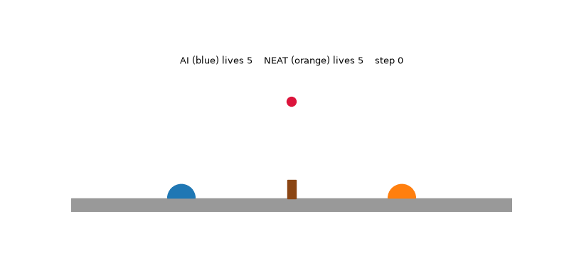
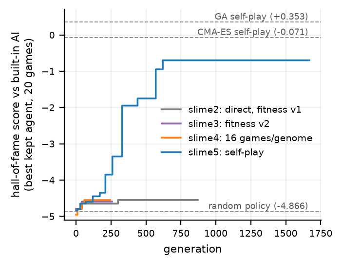
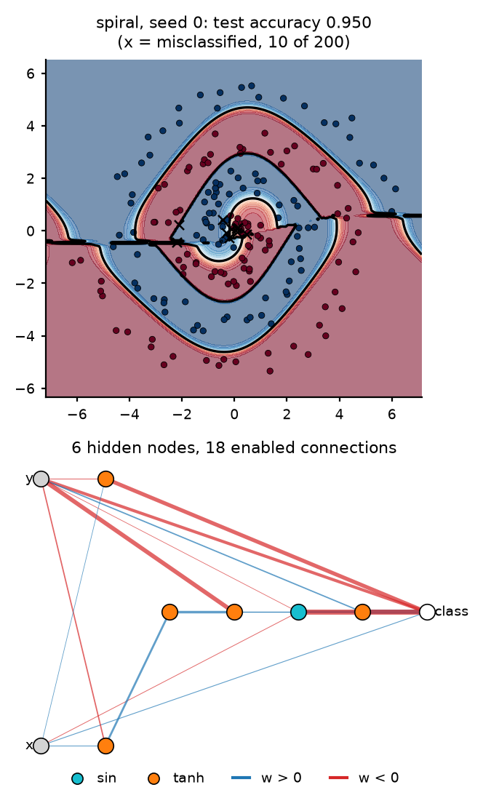

# NEAT from scratch: XOR, Backprop-NEAT in JAX, and Slime Volleyball

A NEAT (NeuroEvolution of Augmenting Topologies) library written from scratch in NumPy, tested on three tasks:

1. **XOR**, as a sanity check.
2. **Backprop-NEAT**: NEAT evolves the architecture, JAX gradient descent trains the weights.
3. **Slime Volleyball**: feed-forward NEAT agents that play the built-in AI from the raw 12-number game state.

📄 **[Full report](docs/report.md)** · 📓 **[Lab notebook](docs/notebook.md)** (every design decision and run)

<p align="center"></p>
<p align="center"><em>The evolved agent (orange) against the built-in AI (blue). Best game of 100, final score +2.</em></p>

## Results

| Task | Result |
|---|---|
| XOR | 10/10 seeds solved in 18.1 ± 9.4 generations, 1–6 hidden nodes |
| Backprop-NEAT, test accuracy (mean of 2 seeds) | circle 0.955 · XOR 0.998 · spiral 0.923, with 5–18 connections |
| Padded + `vmap` training vs one `jit` per genome | 5.9× faster (7.8× once compiled), identical accuracy |
| Slime Volleyball vs built-in AI (1,000 fresh games) | **−0.852 ± 1.260**; 11.8% wins, 31.0% draws, 57.2% losses |

The Slime agent is below all three self-play baselines on the slimevolleygym leaderboard (CMA-ES −0.071, PPO −0.371, GA +0.353), and still loses to the built-in AI on average. The [report](docs/report.md#4-slime-volleyball) covers why.

## Key findings

- **Slime needed four diagnosed failures before it learned.** Each run fixed one measured cause: species cycling → speciation rule; flat fitness → new fitness; noisy rankings → more games; no signal against a strong opponent → self-play.
- **Self-play broke the plateau.** The hall-of-fame score went from −4.85 to −0.70 with 12 self-play games and 4 built-in-AI games per genome.
- **XOR settings did not transfer.** The paper's distance coefficients halved XOR solve time (9.8 vs 18.1 generations, p = 0.015) but made Slime worse. The same happened with more activation mutation.
- **Padding makes NEAT JAX-friendly.** Every genome is packed into a fixed 32-node upper-triangular matrix, so one compiled function trains the whole population.

<p align="center">
  
  
</p>

## Repository layout

```
neat/                 NEAT core (NumPy)
  config.py             every hyperparameter in one frozen dataclass
  genes.py              node and connection genes, Genome
  innovation.py         global innovation registry; split ids keyed by (connection, times split)
  network.py            topological sort, compile-once feed-forward evaluator
  mutation.py           weight, add-connection (cycle-checked), add-node, activation, toggle
  crossover.py          crossover aligned by innovation number
  species.py            compatibility distance, Stanley-rule speciation, adaptive threshold
  reproduction.py       fitness sharing, stagnation, child allocation, elitism
  population.py         generation loop and per-generation statistics
  visualize.py          network drawings
backprop/             Backprop-NEAT (JAX)
  datasets.py           port of backprop-neat-js circle / XOR / spiral generators
  padded.py             genome <-> fixed 32-node arrays, padded forward pass
  train.py              jit(vmap(train_one)) population training, Lamarckian write-back
slime/slimevolley.py  slimevolleygym game, vendored without gym (physics and AI unchanged)
experiments/          scripts that produce every result (see below)
tests/                63 tests
docs/                 report, lab notebook, figures
results/              committed outputs: per-seed CSVs, JSON summaries, raw logs
runs/                 full run outputs, checkpoints and genomes (gitignored, created by the scripts)
```

## Reproducing the results

Needs Python 3.12+ and [uv](https://docs.astral.sh/uv/).

```bash
uv sync
uv run python -m pytest -q tests                        # 63 tests
```

| Result | Command | Output |
|---|---|---|
| XOR, 10 seeds | `uv run python experiments/xor.py` | `results/xor/` |
| XOR mutation sweep | `uv run python experiments/sweep_xor.py` | `runs/sweep_xor/` |
| Backprop-NEAT, 3 datasets × 2 seeds | `uv run python experiments/run_backprop.py` | `runs/backprop/` |
| Padding + vmap benchmark | `uv run python experiments/bench_backprop.py` | `runs/backprop_bench.json` |
| Slime training (reported settings) | `uv run python experiments/run_slime.py --out runs/slime5` | `runs/slime5/` |
| Slime final evaluation | `uv run python experiments/eval_slime.py --run runs/slime5` | `runs/slime5/final_eval.json` |
| GIF of the best agent | `uv run python experiments/watch.py --run runs/slime5 --best-of 100` | `runs/slime5/*.gif` |
| Slime analysis numbers | `uv run python experiments/analyze_slime.py` | `results/slime/` |
| Significance checks | `uv run python experiments/significance.py` | stdout |
| All report figures | `uv run python experiments/make_figures.py` | `docs/figures/` |

- Add `--resume` to `run_slime.py` to continue from the latest checkpoint.
- Every run is deterministic for a given seed.
- slime5 took 4.4 hours on a 16-thread laptop CPU. The Backprop-NEAT grid takes about 10 minutes per run on CPU.
- The ablation settings (slime6, slime7) are noted next to `make_config` in `experiments/run_slime.py`.

## References

- K. O. Stanley and R. Miikkulainen, *Evolving Neural Networks through Augmenting Topologies*, Evolutionary Computation, 2002.
- D. Ha, [slimevolleygym](https://github.com/hardmaru/slimevolleygym): the game, the built-in AI and the baselines.
- D. Ha, [backprop-neat-js](https://github.com/hardmaru/backprop-neat-js): the circle, XOR and spiral datasets.
